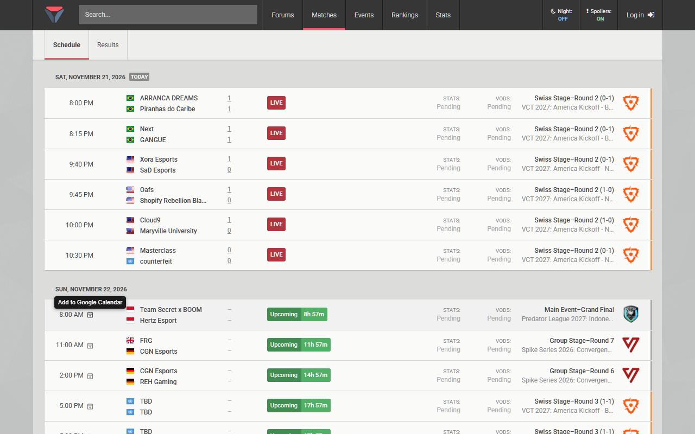

# VLR Calendar

A small browser extension that adds an "Add to Google Calendar" icon to upcoming matches on [vlr.gg](https://www.vlr.gg): match pages, match lists and brackets. Click it and Google Calendar opens with a prefilled event for that single match (teams, event, start time, link back to the match).

Works in Chrome (and Chromium browsers) and Firefox/Zen. No permissions, no data collected.



The event it creates is titled like `TSB vs HZ - Pacific` (team tags and VCT region). The description holds the full team names, the event name and the VLR link, and the length follows the format: Bo1 = 1h15, Bo3 = 3h, Bo5 = 5h.

## Install for local testing

Run `npm i && npm run build` first.

- **Chrome:** `chrome://extensions` -> enable Developer mode -> Load unpacked -> select `dist/chrome`.
- **Firefox / Zen:** `about:debugging#/runtime/this-firefox` -> Load Temporary Add-on -> select `dist/firefox/manifest.json`. Temporary add-ons vanish on restart until the extension is signed or listed on AMO.

## Development

```
npm i
npm run build      # dist/chrome and dist/firefox
npm test           # vitest
npm run typecheck
npm run lint:firefox
npm run icons      # regenerate PNGs from icons/icon.svg
```

## Publishing

`npm run zip` writes `web-ext-artifacts/vlr-calendar-chrome-<version>.zip` and `vlr-calendar-firefox-<version>.zip`. Upload them to the Chrome Web Store dashboard and AMO, using `store/listing.md` for the listing text and `PRIVACY.md` as the privacy policy. The code is not minified, so no separate source upload is needed.

CI (`.github/workflows/ci.yml`) typechecks, tests, builds and lints every push and PR. Pushing a `v*` tag also attaches both zips to the matching GitHub release.

## Timezones

On match pages, vlr.gg's `data-utc-ts` timestamps are in US Eastern time (despite the name). The extension converts them correctly to UTC for the calendar event.

## License

MIT
